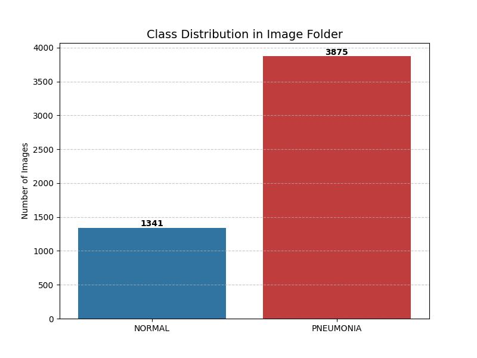
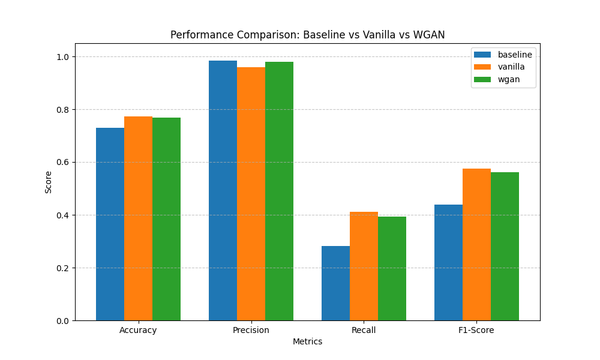
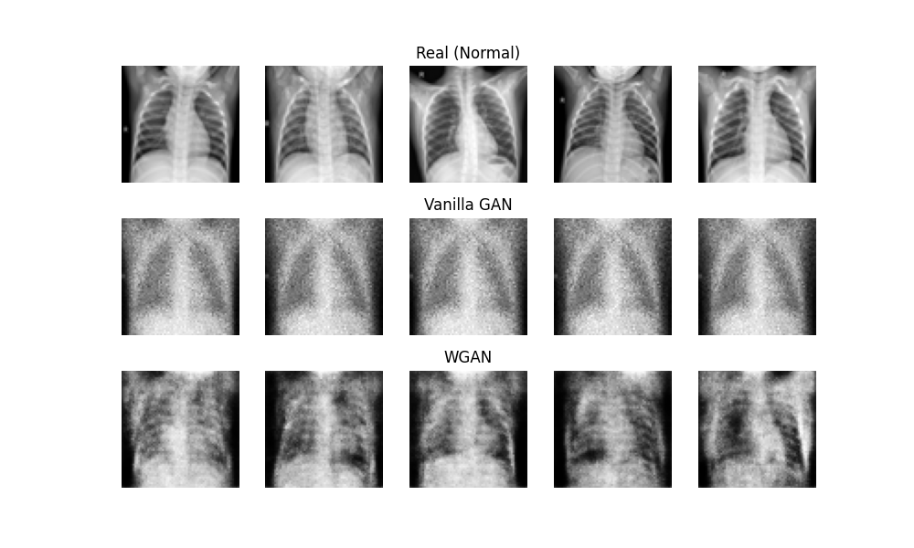
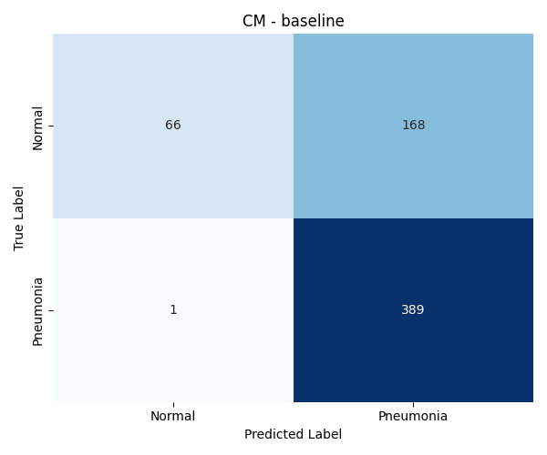
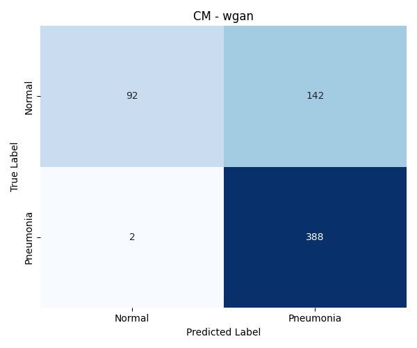

# Exploring GAN Variants for Balancing Imbalanced Medical Datasets

> Training and comparing **Vanilla GAN**, **DCGAN**, and **WGAN** to generate synthetic chest X-ray images for augmenting an imbalanced medical dataset, then evaluating the impact on a CNN classifier's performance.


---

## 📋 Table of Contents

- [Overview](#overview)
- [Dataset](#dataset)
- [Architecture](#architecture)
- [Results](#results)
- [Project Structure](#project-structure)
- [Getting Started](#getting-started)
- [Pipeline Steps](#pipeline-steps)
- [Technologies](#technologies)

---

## Overview

Medical imaging datasets often suffer from severe **class imbalance** — for example, the Chest X-Ray dataset has ~3.9× more Pneumonia images than Normal images. This imbalance biases classifiers toward the majority class, leading to poor recall on the minority class.

This project tackles the problem by:

1. **Training three GAN variants** (Vanilla, DCGAN, WGAN) on the minority class to generate realistic synthetic X-ray images
2. **Augmenting the training set** with the generated images to balance the class distribution
3. **Evaluating a CNN classifier** under three conditions (Baseline, +Vanilla GAN, +WGAN) to measure the impact

---

## Dataset

**Chest X-Ray Images (Pneumonia)** from [Kaggle](https://www.kaggle.com/datasets/paultimothymooney/chest-xray-pneumonia)

| Split | Normal | Pneumonia | Total |
|-------|--------|-----------|-------|
| Train | 1,341  | 3,875     | 5,216 |
| Test  | 234    | 390       | 624   |
| Val   | 8      | 8         | 16    |

The Normal class is the **minority** (~25.7% of training data), making it the target for GAN-based augmentation.

<p align="center">
  
</p>

---

## Architecture

### Vanilla GAN
- **Generator:** 4-layer fully connected network (`z(64) → 256 → 512 → 1024 → 4096`)
- **Discriminator:** 4-layer fully connected network with Sigmoid output
- **Loss:** Binary Cross-Entropy (BCE)
- **Optimizer:** Adam (lr=3e-4)

### DCGAN (Deep Convolutional GAN)
- **Generator:** 5-layer transposed convolutions with BatchNorm + ReLU
- **Discriminator:** 5-layer strided convolutions with BatchNorm + LeakyReLU
- **Loss:** Binary Cross-Entropy (BCE)
- **Optimizer:** Adam (lr=2e-4, β1=0.5)
- Weight initialization following the DCGAN paper (Radford et al., 2015)

### WGAN (Wasserstein GAN)
- **Generator:** Same convolutional architecture as DCGAN
- **Critic:** Same architecture as DCGAN discriminator but **no Sigmoid** (outputs unbounded score)
- **Loss:** Wasserstein distance (Earth Mover's distance)
- **Optimizer:** RMSprop (lr=5e-5) — Adam can cause instability with WGAN
- **Weight clipping** at ±0.01 to enforce Lipschitz constraint
- Critic trained 5× per generator step

### CNN Classifier (Evaluation)
- 3-block CNN: `Conv2d → ReLU → MaxPool` (32 → 64 → 128 channels)
- Fully connected classifier with Dropout(0.5)
- `BCEWithLogitsLoss` for binary classification

---

## Results

### Performance Comparison

| Experiment | Accuracy | Precision | Recall | F1-Score |
|-----------|----------|-----------|--------|----------|
| **Baseline** | 0.7292 | 0.9851 | 0.2821 | 0.4385 |
| **+ Vanilla GAN** | **0.7724** | 0.9600 | **0.4103** | **0.5749** |
| **+ WGAN** | 0.7692 | 0.9787 | 0.3932 | 0.5610 |

> **Key Finding:** Both GAN-augmented experiments significantly improved **Recall** (+45% for Vanilla GAN, +39% for WGAN) and **F1-Score** (+31% for Vanilla GAN, +28% for WGAN) on the minority class, demonstrating that synthetic data augmentation effectively addresses class imbalance.

<p align="center">
  
</p>

### Generated Samples Preview

<p align="center">
  
</p>

### Confusion Matrices

<p align="center">
  
  
  
</p>

---

## Project Structure

```
gan-imbalanced-datasets/
├── src/
│   ├── 01_visualize_imbalance.py       # Visualize class distribution
│   ├── 02_train_vanilla_gan.py         # Train Vanilla GAN
│   ├── 03_generate_vanilla_data.py     # Generate synthetic data (Vanilla)
│   ├── 04_train_dcgan.py               # Train DCGAN
│   ├── 05_generate_dcgan_data.py       # Generate synthetic data (DCGAN)
│   ├── 06_train_wgan.py                # Train WGAN
│   ├── 07_generate_wgan_data.py        # Generate synthetic data (WGAN)
│   └── 08_evaluate_classifiers.py      # Train CNN & compare all experiments
├── results/
│   ├── Imbalance_Distribution.jpg      # Class distribution plot
│   ├── generated_samples_preview.png   # Sample generated images
│   ├── metrics_comparison.png          # Accuracy/Precision/Recall/F1 chart
│   ├── cm_baseline.png                 # Confusion matrix — baseline
│   ├── cm_vanilla.png                  # Confusion matrix — Vanilla GAN
│   └── cm_wgan.png                     # Confusion matrix — WGAN
├── docs/
│   └── Exploring_GAN_Variants_for_Balancing_Imbalanced_Datasets.pdf
├── .gitignore
├── requirements.txt
└── README.md
```

> **Note:** The dataset (`chest_xray/`), model checkpoints (`.pth`), and generated images are excluded from the repo via `.gitignore` due to their large size. See [Getting Started](#getting-started) for download instructions.

---

## Getting Started

### Prerequisites

- Python 3.10+
- CUDA-compatible GPU (recommended for training)

### Installation

```bash
# Clone the repository
git clone https://github.com/YOUR_USERNAME/gan-imbalanced-datasets.git
cd gan-imbalanced-datasets

# Create a virtual environment
python -m venv venv
source venv/bin/activate        # Linux/Mac
venv\Scripts\activate           # Windows

# Install dependencies
pip install -r requirements.txt
```

### Download the Dataset

1. Download the [Chest X-Ray Dataset](https://www.kaggle.com/datasets/paultimothymooney/chest-xray-pneumonia) from Kaggle
2. Extract it into the project root so the structure is:
   ```
   gan-imbalanced-datasets/
   └── chest_xray/
       ├── train/
       │   ├── NORMAL/
       │   └── PNEUMONIA/
       ├── test/
       └── val/
   ```

---

## Pipeline Steps

Run the scripts **in order** from the project root directory:

```bash
# Step 1: Visualize the class imbalance
python src/01_visualize_imbalance.py

# Step 2–3: Train Vanilla GAN & generate synthetic images
python src/02_train_vanilla_gan.py
python src/03_generate_vanilla_data.py

# Step 4–5: Train DCGAN & generate synthetic images
python src/04_train_dcgan.py
python src/05_generate_dcgan_data.py

# Step 6–7: Train WGAN & generate synthetic images
python src/06_train_wgan.py
python src/07_generate_wgan_data.py

# Step 8: Evaluate all three experiments
python src/08_evaluate_classifiers.py
```

---

## Technologies

- **PyTorch** — Deep learning framework (GANs + CNN)
- **torchvision** — Image transforms and dataset loading
- **scikit-learn** — Classification metrics and evaluation
- **Matplotlib / Seaborn** — Visualization
- **NumPy / Pillow** — Numerical operations and image handling
